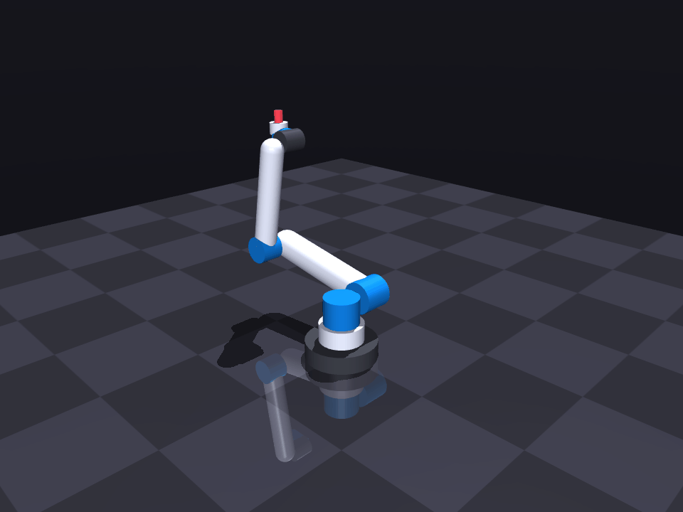

# Robot Kinematics Simulator (2D & 3D)

 A modular robotics simulation tool for forward/inverse kinematics and smooth trajectory planning, featuring photorealistic 3D visualization powered by the MuJoCo physics engine.

 

## Features
 - **Kinematics Engine:** Forward kinematics for planar 3R and spatial 6-DOF manipulators (UR5 parameters via standard Denavit-Hartenberg matrices).
 - **Inverse Kinematics:** Analytical IK solver for planar 3-DOF arms with geometric workspace boundary checks.
 - **Trajectory Planning:** Jerk-limited, C2-continuous motion profiles based on quintic polynomial interpolation.
 - **Photorealistic Simulation:** Studio-grade rendering featuring contact shadows, PBR metallic shaders, and ground reflections via MuJoCo.
 - **Automated Testing:** Fully automated unit test suite with `pytest` for kinematic precision verification.

## Installation

 Clone the repository and install dependencies:

 ```bash
 git clone https://github.com/Seyo2412/robot-kinematics-simulator.git
 cd robot-kinematics-simulator
 python3 -m venv venv
 source venv/bin/activate
 pip install -r requirements.txt
 ```

 ## Usage

 Run the 2D planar arm simulation:

 ```bash
 python main.py
 ```

 Render the photorealistic MuJoCo simulation GIF:
 ```bash
 python render_mujoco.py
 ```

 Run the automated test suite:

 ```bash
 pytest
 ```

## Roadmap

 - [x] Planar 3R Forward Kinematics
 - [x] Inverse Kinematics (IK) via Analytical Methods
 - [x] Trajectory Planning (quintic polynomial interpolation)
 - [x] 3D Kinematics for 6-DOF Manipulator (UR5 Industrial Arm)
 - [x] Photorealistic Studio Rendering (MuJoCo Physics Engine)
 - [x] Automated Unit Test Suite (pytest)